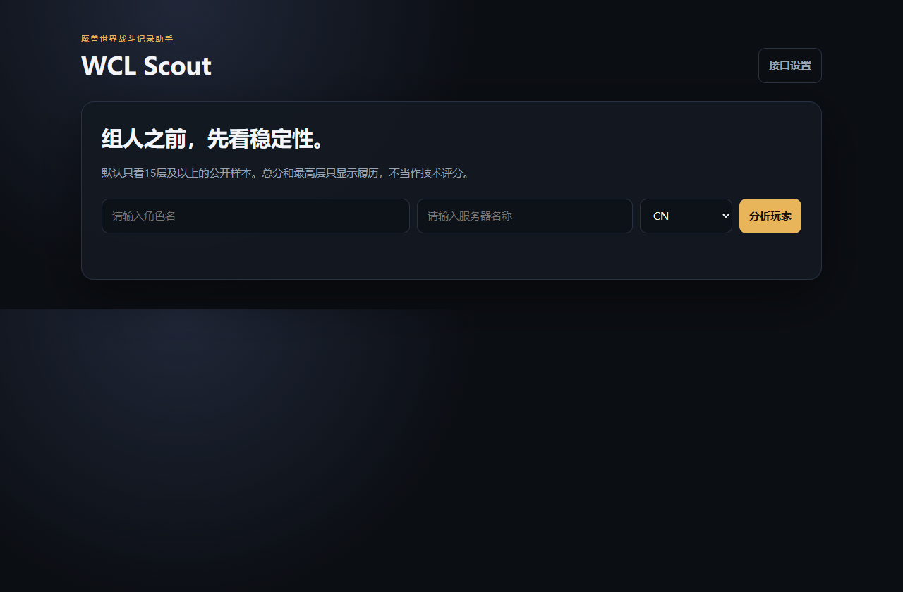
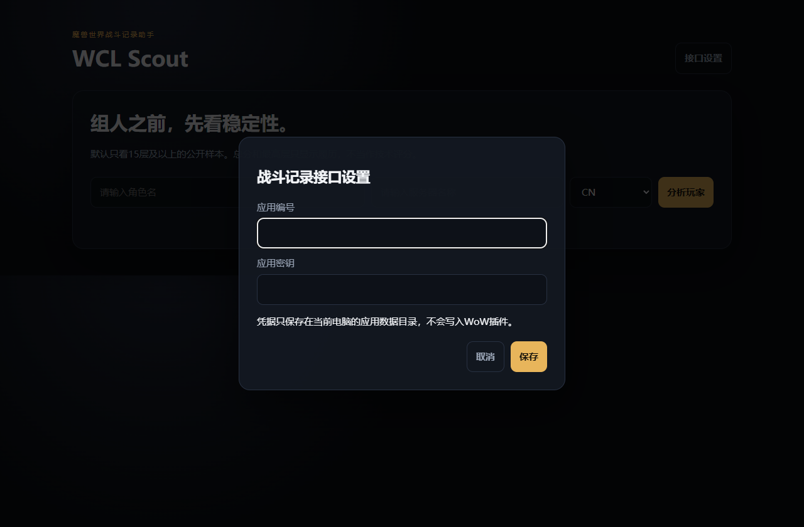

# 战斗记录助手安装指南

这份指南按“第一次安装插件”的顺序写。不需要打开命令行。请先看下面的准备清单，再从第一步开始。

## 安装前准备

- 一台运行正式服《魔兽世界》的视窗电脑。
- 能访问魔兽世界战斗记录网站，并拥有自己的账户及该网站提供的第二版应用编号和应用密钥。**不要把密钥发给别人，也不要上传到公开仓库。**
- 电脑已安装运行环境。若双击启动文件后提示“找不到运行环境”，请从 [运行环境官方网站的中文下载页](https://nodejs.org/zh-cn/download)安装长期支持版，然后重新打开安装包。

本程序由“游戏插件”和“本地助手”两部分组成。游戏插件显示队员和查询结果；本地助手负责访问战斗记录网站。**查询新玩家时，两部分都要运行。**

## 第一步：下载并解压

打开[项目下载页](https://github.com/chenergouzi117/wcl-scout)。可以下载仓库里的安装压缩包，也可以点击页面上的“代码”按钮，再点“下载压缩文件”。下载完成后，右键压缩包选择“全部解压”。请把它解压到一个固定位置，例如“文档”文件夹；不要直接在压缩包预览窗口中运行。

解压后，应能看到 `start-wcl-scout.cmd` 和 `addon` 文件夹。如果只看到一个同名文件夹，请再打开一层。

## 第二步：把游戏插件放进魔兽世界

1. 在战网启动器里找到《魔兽世界》，打开游戏安装位置。
2. 依次进入 `_retail_`、`Interface`、`AddOns` 文件夹。
3. 从解压好的安装包中复制 `addon` 里面的 `WCLScout` 文件夹，粘贴到 `AddOns` 里面。
4. 核对最终位置：`AddOns/WCLScout/WCLScout.toc`。如果变成 `AddOns/WCLScout/WCLScout/WCLScout.toc`，就是多套了一层文件夹，请调整。
5. 完全退出并重新进入游戏，确认角色选择界面的“插件”列表中有战斗记录助手。

如果你的游戏不在常见位置，本地助手可能找不到它。此时在解压目录新建一个名为 `wow-path.txt` 的文本文件，只写正式服 `_retail_` 文件夹的完整路径，保存后重启本地助手。这个文件只保存在你的电脑，不会上传。

## 第三步：启动本地助手

双击解压目录中的 `start-wcl-scout.cmd`。出现的黑色窗口要保持打开，关闭窗口就不能查询新玩家。浏览器访问 <http://127.0.0.1:17385>，能看到下图就表示本地助手已启动。

如果浏览器没有自动打开，请手动输入上面的地址。这个地址只连接你自己的电脑，不是把角色资料上传到一个公开网站。

## 第四步：首次填写网站凭据

第一次启动时，点击主页右上角的“接口设置”。把你在魔兽世界战斗记录网站申请的**第二版应用编号**和**应用密钥**分别填入两个框，再点“保存”。这里只填写你自己的凭据，不能使用别人公开过的密钥。

凭据只保存在这台电脑的应用数据目录，不写入游戏插件，也不包含在下载包里。以后正常启动，无需重复填写。

## 第五步：在游戏里查询

进入游戏后，在聊天框输入 `/wcls` 打开插件界面。你可以在队伍、团队或集合石申请者列表中选中想查的人：

1. 点击“单查”只查这一人；点击“深度分析”读取更多战斗数据；“一键全查”只查询当前列表中的人，不会自动扫描所有申请者。
2. 在聊天框输入 `/reload`，让游戏把待查名单提交给本地助手。
3. 普通查询等待约数秒；深度分析通常需要更久，网站限流时也可能延长。此时保持本地助手窗口打开。
4. 再输入一次 `/reload`，游戏就会读入新结果。若还显示“处理中”，稍等片刻后再重载一次。

查询自己的角色，可以使用“成长分析”，查看较低层数的公开记录。默认组人评价主要看十五层及以上；低层记录不足时，不应把“没有评分”当成玩家技术差。

## 常见问题

**双击启动文件后，黑窗一闪就没了。** 请先确认运行环境已安装，再从解压后的文件夹运行。新版启动文件会在报错后停住，照着窗口提示处理即可。

**浏览器显示无法连接。** 本地助手没有启动，或者黑色窗口已经关闭。重新双击启动文件，并检查浏览器地址是否是 `127.0.0.1:17385`。

**游戏里找不到插件。** 检查文件夹是否放在正式服的 `_retail_/Interface/AddOns/WCLScout`，尤其检查有没有多套一层同名文件夹；然后完全重启游戏。

**查完后还是旧数据。** 本程序依靠游戏重载来交换名单和结果。点击查询后需要一次 `/reload` 提交，等本地助手完成，再一次 `/reload` 读入。已经缓存的数据可离线查看，但新查询必须开启本地助手。

**显示“待验证”或没有技术分。** 这表示该专精的完整战斗样本还不足以可靠地给手法打分，不代表零分。副本路线、合波、装备和队友表现也会影响输出。

**只有横杠，没有装等或大秘境分。** 游戏本身未提供该成员的即时资料时会这样显示，不影响查到的公开战斗记录；不要把横杠当作零分。

## 隐私提醒

不要分享本地配置文件、游戏日志或生成后的 `Data.lua`：里面可能包含你的密钥或查询过的玩家资料。公开安装包中的 `Data.lua` 是空白文件。卸载时可以删除游戏目录里的 `WCLScout` 文件夹；本地助手的设置和缓存仍留在这台电脑，需要另行处理。
